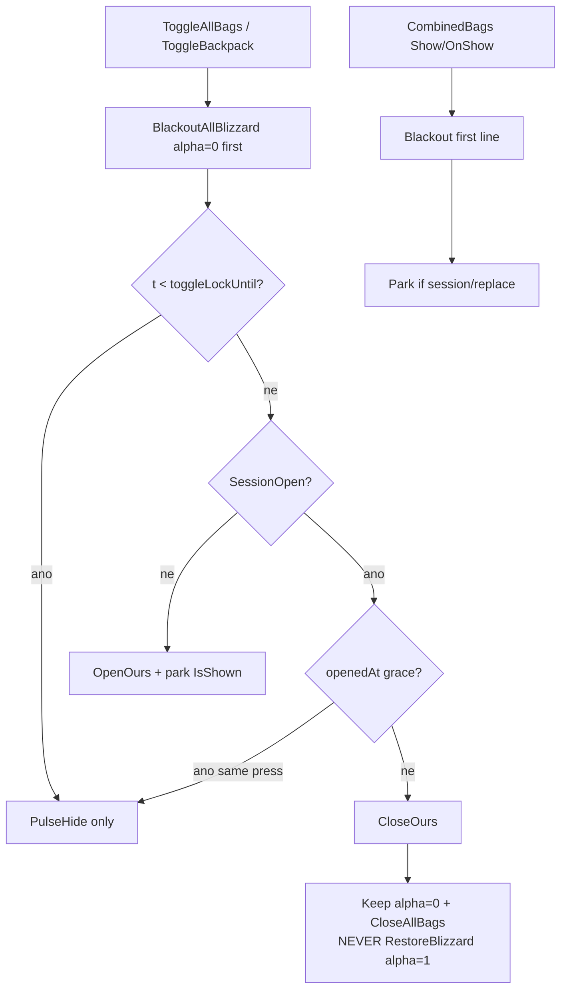
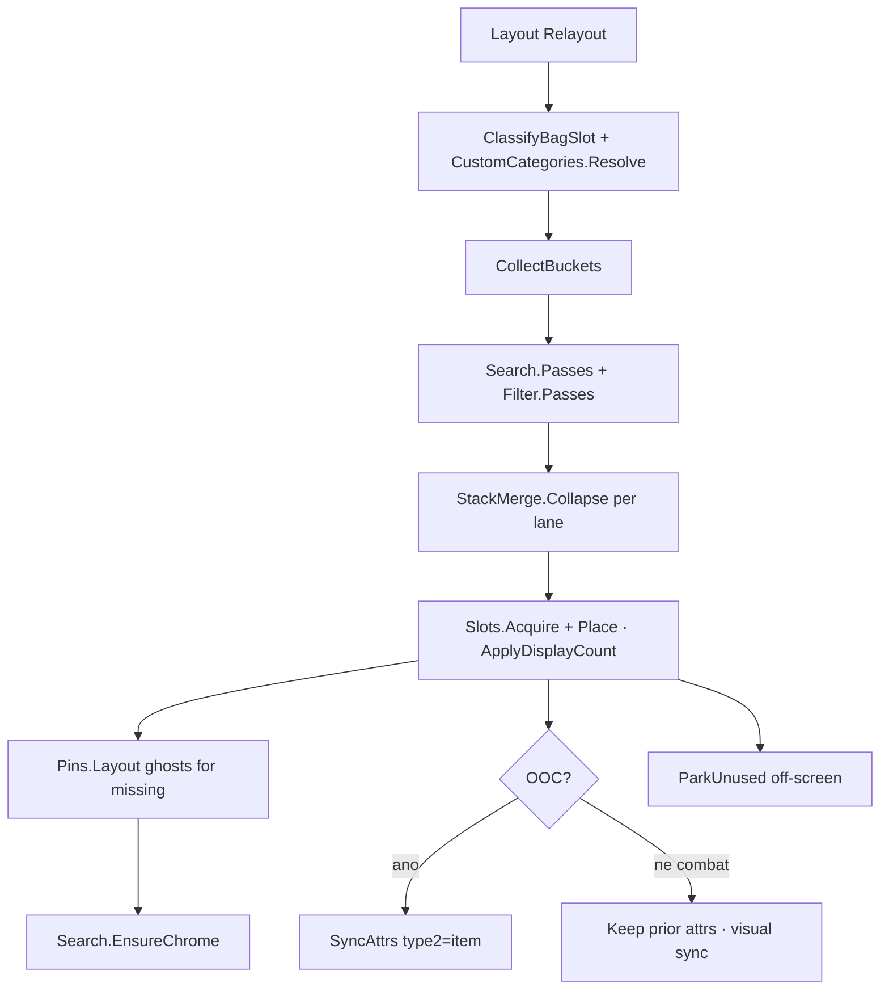
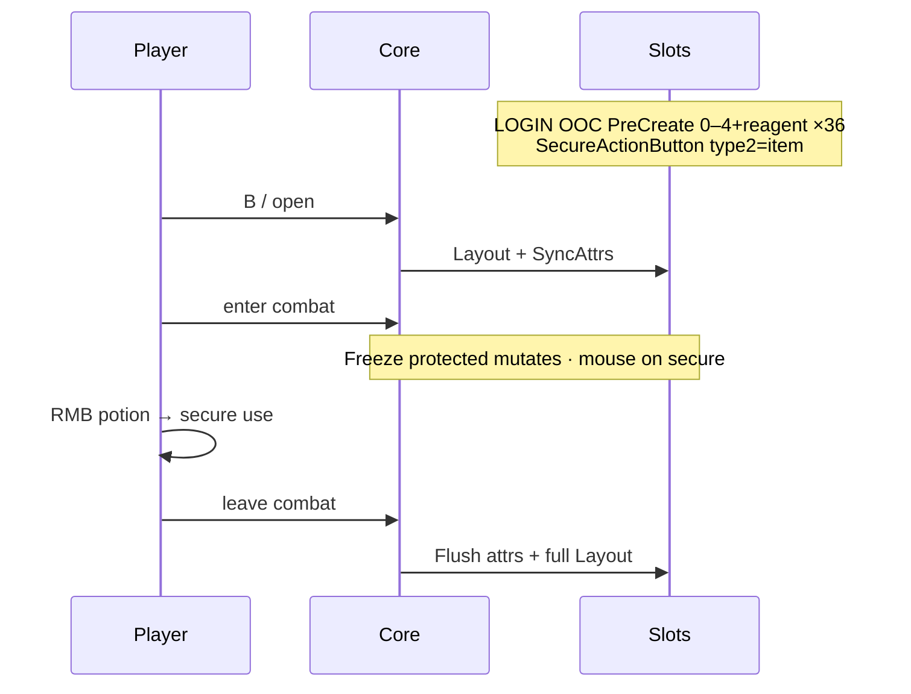
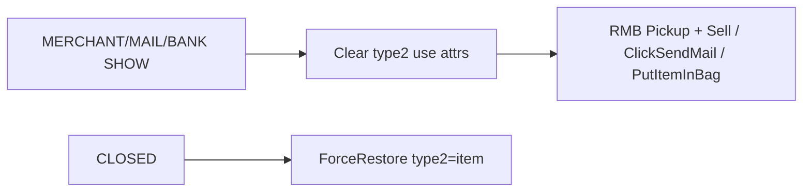

# BetterBackpack — smyčky a grafy

**Kód:** `Core.lua`, `Modules/{Slots,Layout,Context,OpenClose,Tidy,Settings,Search,Filter,CustomCategories,StackMerge,Pins,LayoutModes}.lua`  
**Verze reference:** 0.3.0-nth (feature branch `betterbackpack/features-nth`)  
**Stabilita:** Project `docs/bag-addon-brief.md` + Scenario Maps `docs/scenarios/BetterBackpack/`  
**CS-RMB:** path **B** — `SecureActionButtonTemplate` attrs OOC (never path C harvest).

---

## 1. Open / close (B → BetterBackpack)



**Pravidla**

- Nikdy `SetOverrideBindingClick`.
- Anti-flash: `Show`/`OnShow`/`onToggle` → **Blackout alpha=0 first**; CloseOurs never `RestoreBlizzardBags`.
- CombinedBags stays `IsShown`+parked while ours open — **ne** `:Hide()` mid-session.
- `SuppressReplace`; OnShow nesmí ClearSuppress→OpenOurs.
- Grace ≠ `toggleLockUntil`; OpenAllBags while open must not extend lock.
- Open: Toggle* XOR; **OpenAllBags/OpenBag/ToggleBag/bag-bar** open intent. Keys/keyring lane. N/M centered. Hug-content height.

---

## 2. Layout — own SAB only (+ NTH feature hooks)



Žádný harvest / `SetParent` CombinedBags.Items.  
Feature modules are optional `Feat("Name")` lookups — TOC can omit a file without Layout crash.  
`LayoutModes.Columns` densifies grid; stack merge is visual-only (first real bag:slot keeps clicks).

---

## 3. Combat RMB (CS-RMB)



---

## 4. Vendor / mail / bank



Mail: `MailFrame:IsVisible()` — ne stuck SendMailFrame alone.

---

## 5. Sort OOC

```mermaid
flowchart TD
  Sort[/bb sort]
  Sort --> Combat{InCombatLockdown?}
  Combat -->|ano| Defer[message · bail]
  Combat -->|ne| Native[C_Container.SortBags]
  Native --> Settle[suppress refresh · one Layout ~0.55s]
```
