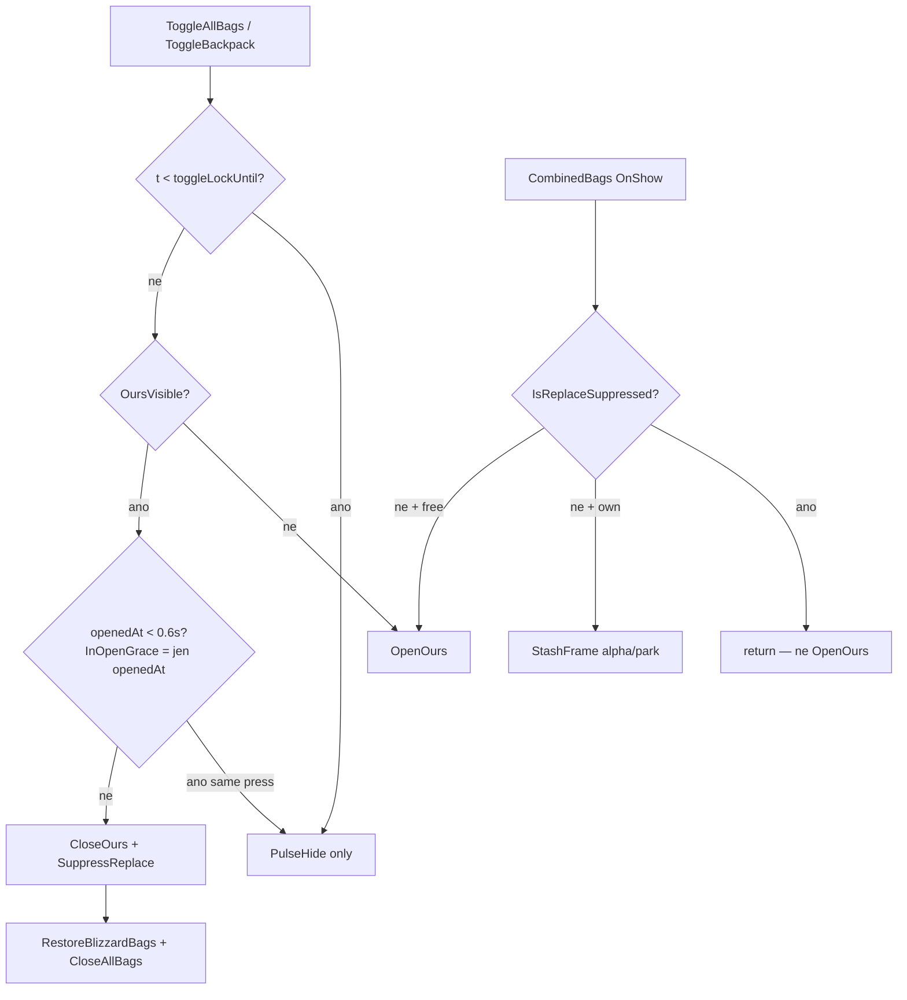
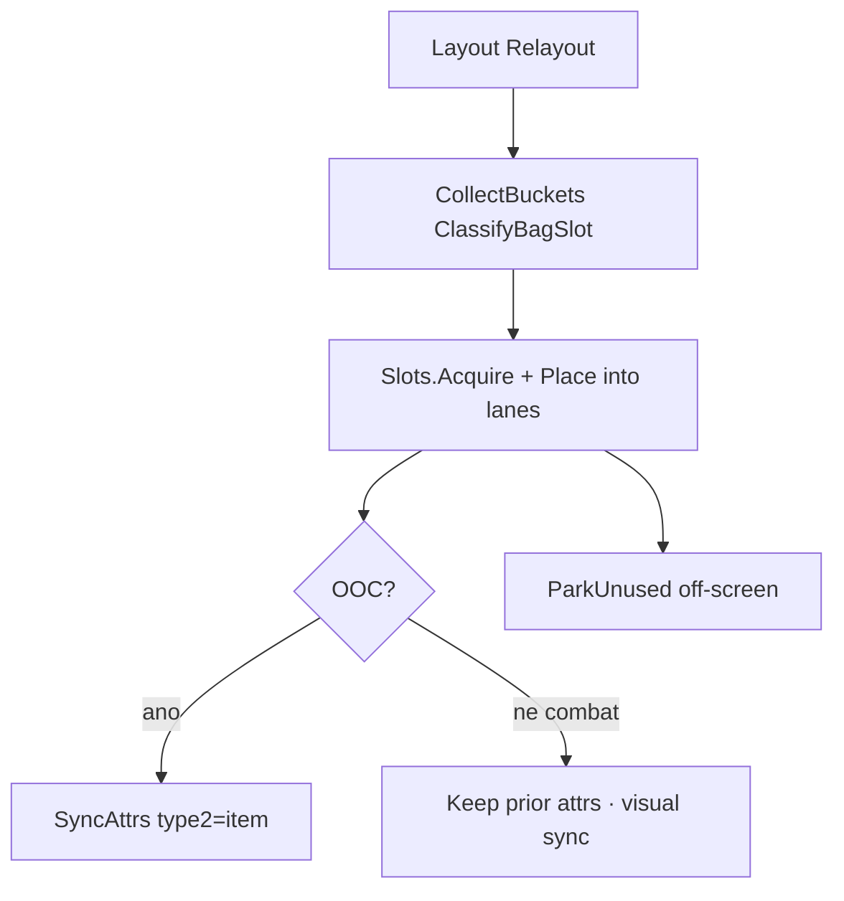
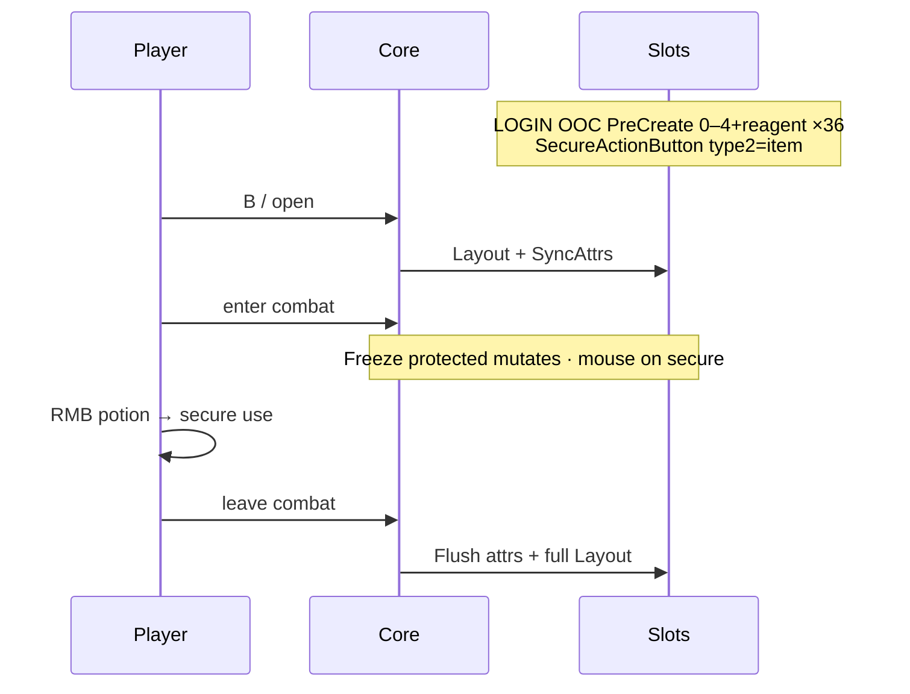
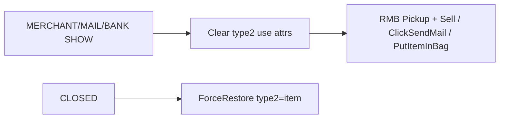

# BetterBackpack — smyčky a grafy

**Kód:** `Core.lua`, `Modules/{Slots,Layout,Context,OpenClose,Tidy}.lua`  
**Verze reference:** 0.1.0  
**Stabilita:** Project `docs/bag-addon-brief.md` + Scenario Maps `docs/scenarios/BetterBackpack/`  
**CS-RMB:** path **B** — `SecureActionButtonTemplate` attrs OOC (never path C harvest).

---

## 1. Open / close (B → BetterBackpack)



**Pravidla**

- Nikdy `SetOverrideBindingClick`.
- CombinedBags `:Show()` + `SetAlpha(0)` + park — **ne** `:Hide()`.
- `SuppressReplace`; OnShow nesmí ClearSuppress→OpenOurs.
- Grace ≠ `toggleLockUntil`.
- Watchdog restash; heal ≤1×/s.

---

## 2. Layout — own SAB only



Žádný harvest / `SetParent` CombinedBags.Items.

---

## 3. Combat RMB (CS-RMB)



---

## 4. Vendor / mail / bank



Mail: `MailFrame:IsVisible()` — ne stuck SendMailFrame alone.

---

## 5. Sort OOC

```mermaid
flowchart TD
  Sort[/bb sort]
  Sort --> Combat{InCombatLockdown?}
  Combat -->|ano| Defer[message · bail]
  Combat -->|ne| Native[C_Container.SortBags]
  Native --> Settle[suppress refresh · one Layout ~0.55s]
```
