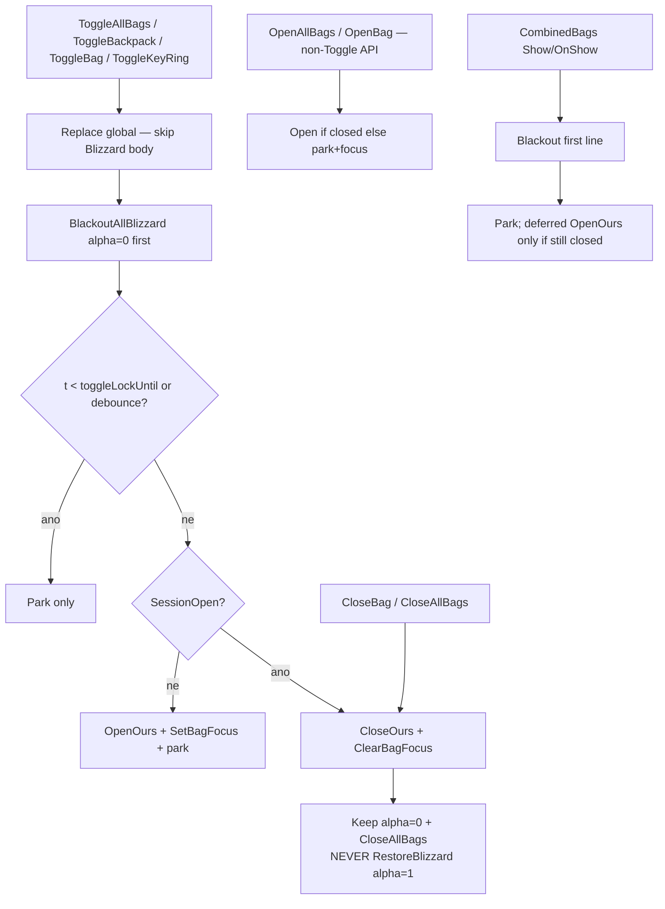
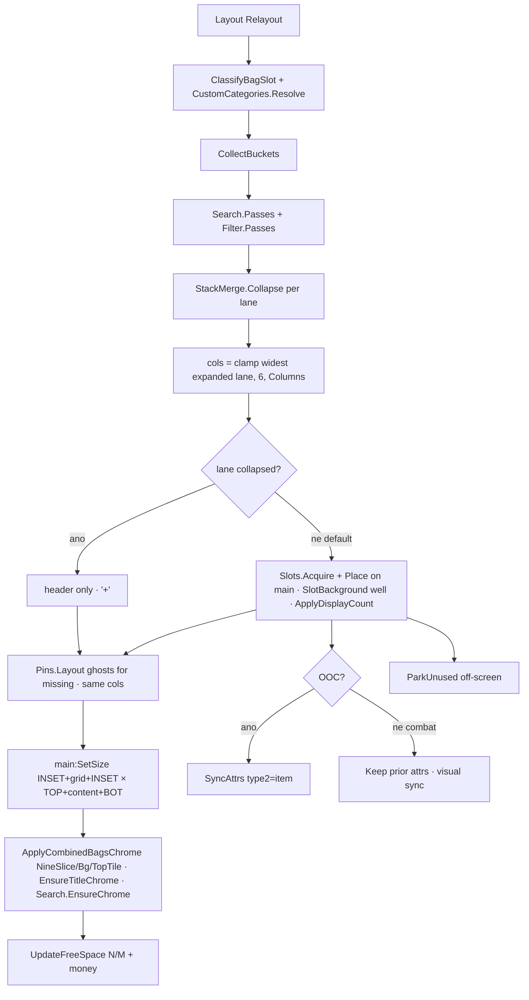
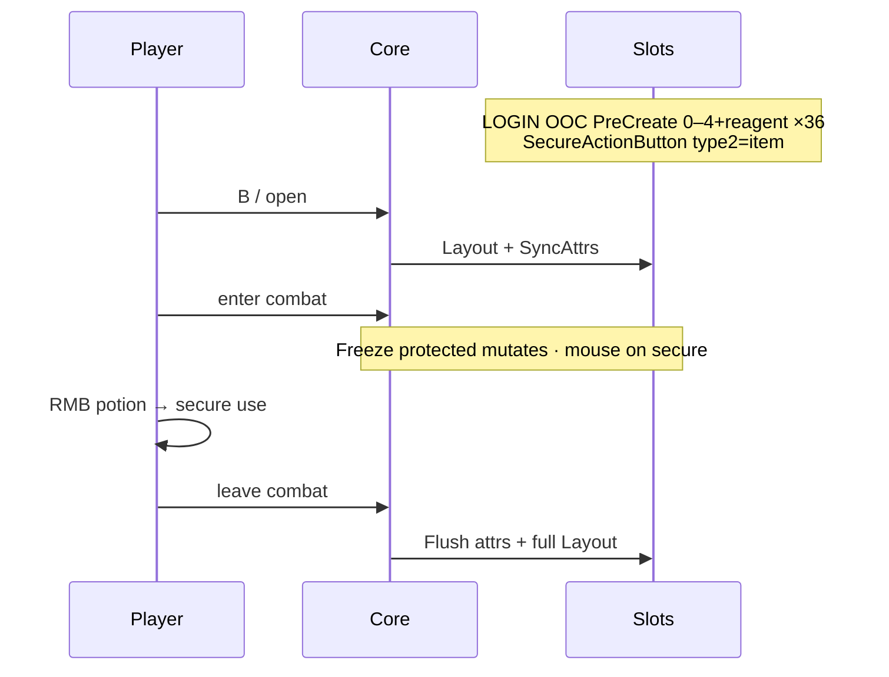
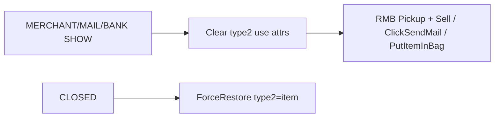

# BetterBackpack — smyčky a grafy

**Kód:** `Core.lua`, `Modules/{Slots,Layout,Context,OpenClose,Tidy,Settings,Search,Filter,CustomCategories,StackMerge,Pins,LayoutModes}.lua`  
**Verze reference:** 0.5.6 (chrome skutečně aplikovaný v DoLayout · hug-width grid · kategorie default rozbalené)  
**Stabilita:** Project `docs/bag-addon-brief.md` + Scenario Maps `docs/scenarios/BetterBackpack/`  
**CS-RMB:** path **B** — `SecureActionButtonTemplate` attrs OOC (never path C harvest).

---

## 1. Open / close (B → BetterBackpack)



**Pravidla**

- Nikdy `SetOverrideBindingClick`.
- Forever: never call `SetFrameStrata` / `SetToplevel` in Lua. **0.5.5+:** `ButtonFrameTemplate` + CombinedBags NineSlice/TopTile/Bg at Baganator Forever offsets (6,-21); **Inset:Hide**; empty `SlotBackground` on slots; footer inside bottom border.
- **0.5.3+:** `Toggle*` are **replaced**, not `hooksecurefunc`. Post-hooks ran after Blizzard `Open*`/`Close*` → open/close thrash that froze on B.
- Anti-flash: `Show`/`OnShow`/`onToggle` → **Blackout alpha=0 first**; CloseOurs never `RestoreBlizzardBags`. OpenOurs fail → `ForceCloseBlizzard` (not Unblackout).
- CombinedBags stays `IsShown`+parked while ours open — **ne** `:Hide()` mid-session.
- `SuppressReplace`; OnShow nesmí ClearSuppress→OpenOurs.
- **ToggleBag + bag-bar OnClick = XOR** (same as B; `toggleLockUntil` after replaced ToggleBag). OpenBag/OpenAllBags = open-only. CloseBag/CloseAllBags close ours.
- HookScript OnClick only on frames with `HasScript("OnClick")` / Button — never throw on BagsBar chrome kids.
- Bag focus: `Layout.SetBagFocus(id)` highlights that bag’s slots after open.
- Frame size (**0.5.6 hug**): `cols = clamp(nejširší rozbalená lane, MIN_COLS=6, Columns())` (Columns = profile 10, dense ≥12). Grid = `cols*37 + (cols-1)*4`; outer = `INSET_X + grid + INSET_X` (symetricky, INSET_X=14); výška = TOP_CHROME 54 + obsah + BOT_CHROME 30. Žádný prázdný pruh vpravo.
- Kategorie jsou **default rozbalené**; `[+]/[-]` header = per-profile toggle. Schema 3 (0.5.6) jednorázově maže `collapsed` zaseknutý z 0.5.4/0.5.5 (prázdné lanes → hráč zavřel všechny headery).
- Lua 5.1: helper volaný z `DoLayout` / `SyncVisual` / `Acquire` musí být deklarovaný **nad** volajícím (nebo forward `local X` + `X = function`). 0.5.4/0.5.5 volaly `ApplyCombinedBagsChrome` / `EnsureSlotBackground` jako nil global → DoLayout abort na prvním itemu (žádné ikony, frame se nezmenšil).
- Title chrome: AutoSort **twins** (same native size, atlas art, no ADD glow); broom | gear | X. No native reparent.
- Footer N/M: player bags `0..NUM_BAG_SLOTS` + **reagent bag** (Materials lane). Never keyring invent (102=70+32).
- Slots: `Normalize` 37×37 on every `Place` and after `SetItemButtonQuality`.
- CombinedBags/Container OnShow: park now; **defer** open to next tick (non-Toggle Open* only).

---

## 2. Layout — own SAB only (+ NTH Feat hooks)



Žádný harvest / `SetParent` CombinedBags.Items.  
Feature modules are optional `Feat("Name")` lookups — TOC can omit a file without Layout crash.  
`LayoutModes.Columns` densifies grid; stack merge is visual-only (first real bag:slot keeps clicks).  
Title chrome / AutoSort twins remain the 0.4.x path — NTH does not own OpenClose.

---

## 3. Combat RMB (CS-RMB)



---

## 4. Vendor / mail / bank



Mail: `MailFrame:IsVisible()` — ne stuck SendMailFrame alone.

---

## 5. Sort OOC

```mermaid
flowchart TD
  Sort[/bb sort]
  Sort --> Combat{InCombatLockdown?}
  Combat -->|ano| Defer[message · bail]
  Combat -->|ne| Native[C_Container.SortBags]
  Native --> Settle[suppress refresh · one Layout ~0.55s]
```
