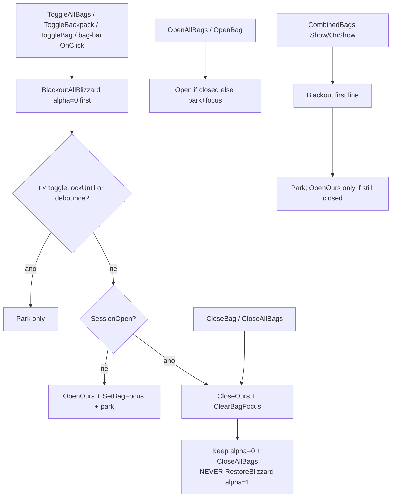
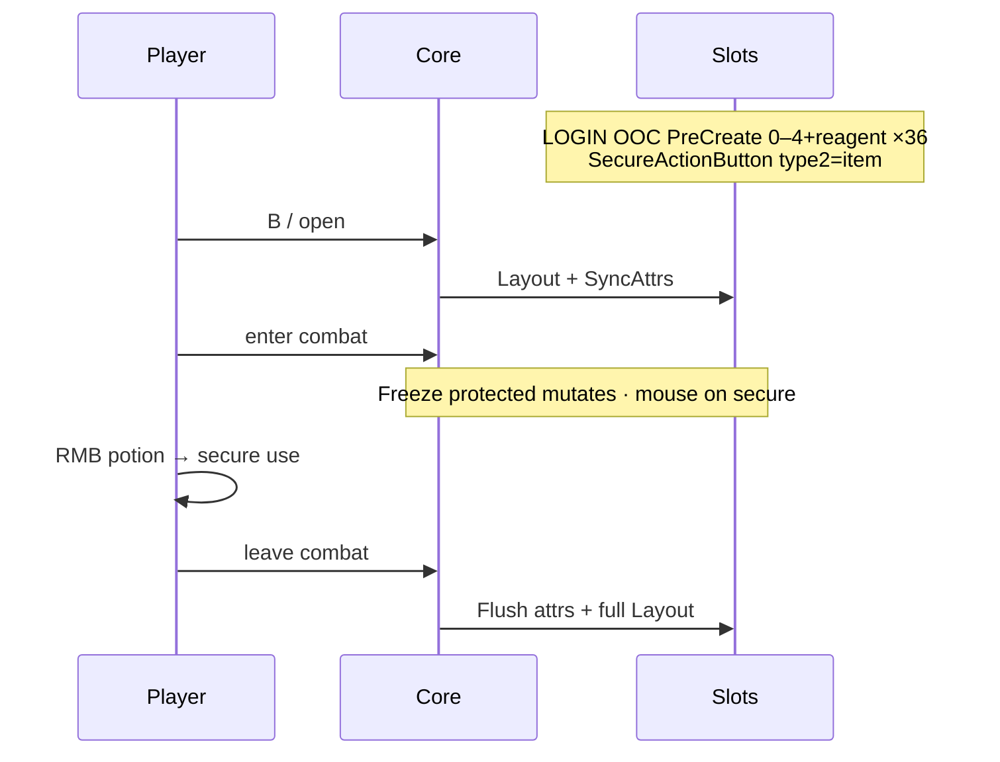
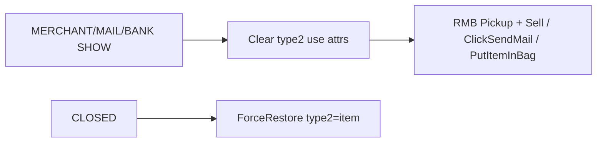

# BetterBackpack — smyčky a grafy

**Kód:** `Core.lua`, `Modules/{Slots,Layout,Context,OpenClose,Tidy,Settings,Search,Filter,CustomCategories,StackMerge,Pins,LayoutModes}.lua`  
**Verze reference:** 0.5.1 (features-nth merged onto 0.4.2 chrome)  
**Stabilita:** Project `docs/bag-addon-brief.md` + Scenario Maps `docs/scenarios/BetterBackpack/`  
**CS-RMB:** path **B** — `SecureActionButtonTemplate` attrs OOC (never path C harvest).

---

## 1. Open / close (B → BetterBackpack)



**Pravidla**

- Nikdy `SetOverrideBindingClick`.
- Forever: `SetFrameStrata` on BetterBackpackFrame can BLOCKED+error — always `pcall` (0.5.1 OpenOurs false).

- Anti-flash: `Show`/`OnShow`/`onToggle` → **Blackout alpha=0 first**; CloseOurs never `RestoreBlizzardBags`.
- CombinedBags stays `IsShown`+parked while ours open — **ne** `:Hide()` mid-session.
- `SuppressReplace`; OnShow nesmí ClearSuppress→OpenOurs.
- **ToggleBag + bag-bar OnClick = XOR** (same as B). OpenBag/OpenAllBags = open-only. CloseBag/CloseAllBags close ours.
- HookScript OnClick only on frames with `HasScript("OnClick")` / Button — never throw on BagsBar chrome kids.
- Bag focus: `Layout.SetBagFocus(id)` highlights that bag’s slots after open.
- Frame size: **10 cols** default (CombinedBags/BagShelves); INSET_X=14, TOP_CHROME=58, BOT_CHROME=32; outer = contentW+INSET_X+28.
- Title chrome: AutoSort **twins** (same native size, atlas art, no ADD glow); broom | gear | X. No native reparent.
- Footer N/M: player bags `0..NUM_BAG_SLOTS` + **reagent bag** (Materials lane). Never keyring invent (102=70+32).
- Slots: `Normalize` 37×37 on every `Place` and after `SetItemButtonQuality`.
- CombinedBags/Container OnShow: park now; **defer** open to next tick so Toggle* XOR runs first.

---

## 2. Layout — own SAB only (+ NTH Feat hooks)

```mermaid
flowchart TD
  L[Layout Relayout]
  L --> Class[ClassifyBagSlot + CustomCategories.Resolve]
  Class --> Buckets[CollectBuckets]
  Buckets --> SF[Search.Passes + Filter.Passes]
  SF --> Merge[StackMerge.Collapse per lane]
  Merge --> Place[Slots.Acquire + Place on main · ApplyDisplayCount]
  Place --> Pins[Pins.Layout ghosts for missing]
  Pins --> Chrome[EnsureTitleChrome + Search.EnsureChrome]
  Place --> Attrs{OOC?}
  Attrs -->|ano| Sync[SyncAttrs type2=item]
  Attrs -->|ne combat| Keep[Keep prior attrs · visual sync]
  Place --> Unused[ParkUnused off-screen]
```



Žádný harvest / `SetParent` CombinedBags.Items.  
Feature modules are optional `Feat("Name")` lookups — TOC can omit a file without Layout crash.  
`LayoutModes.Columns` densifies grid; stack merge is visual-only (first real bag:slot keeps clicks).  
Title chrome / AutoSort twins remain the 0.4.x path — NTH does not own OpenClose.

---

## 3. Combat RMB (CS-RMB)



---

## 4. Vendor / mail / bank



Mail: `MailFrame:IsVisible()` — ne stuck SendMailFrame alone.

---

## 5. Sort OOC

```mermaid
flowchart TD
  Sort[/bb sort]
  Sort --> Combat{InCombatLockdown?}
  Combat -->|ano| Defer[message · bail]
  Combat -->|ne| Native[C_Container.SortBags]
  Native --> Settle[suppress refresh · one Layout ~0.55s]
```
