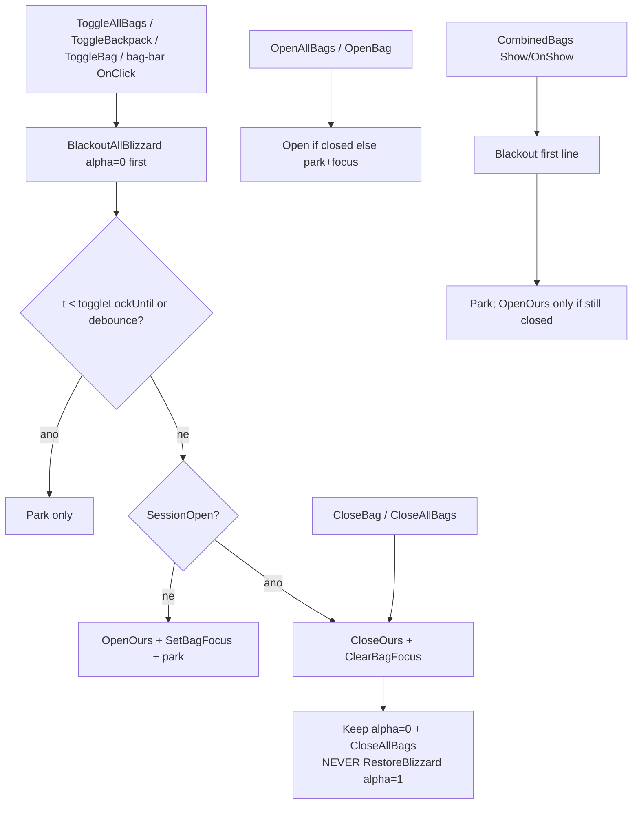
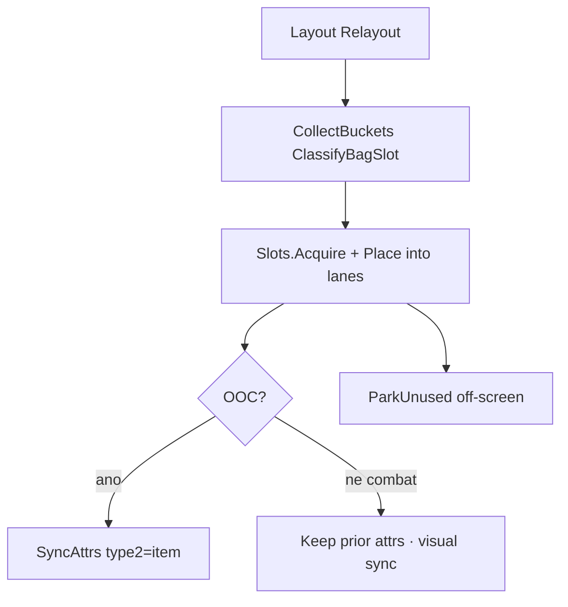
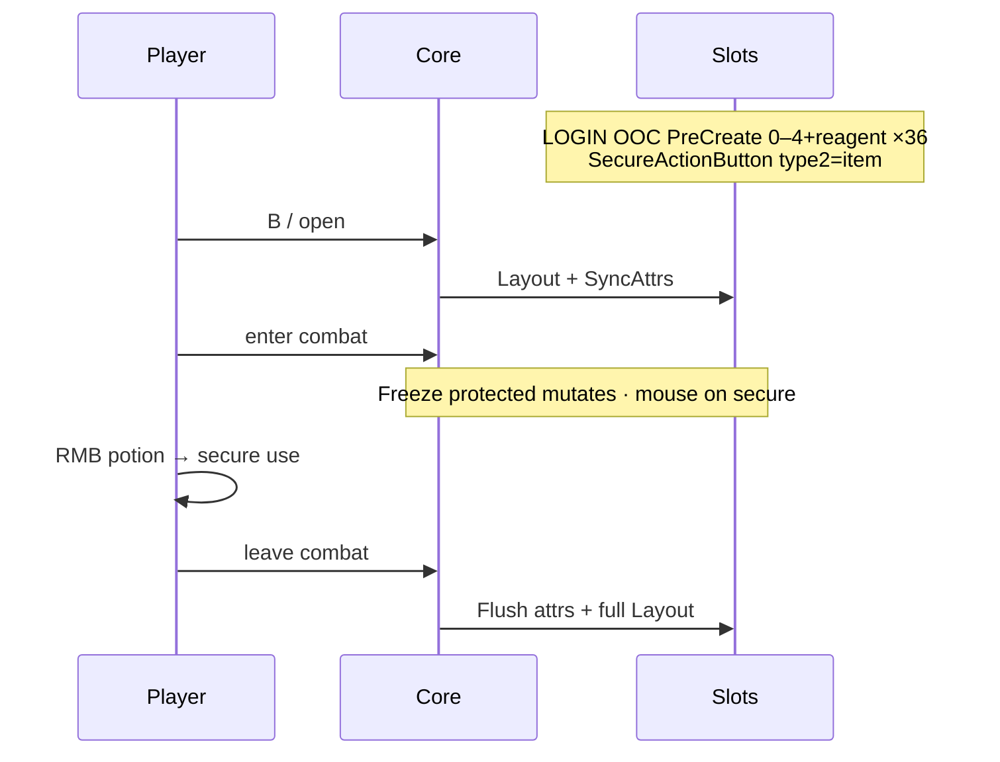
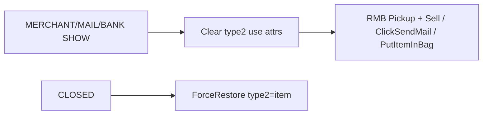

# BetterBackpack — smyčky a grafy

**Kód:** `Core.lua`, `Modules/{Slots,Layout,Context,OpenClose,Tidy}.lua`  
**Verze reference:** 0.3.9  
**Stabilita:** Project `docs/bag-addon-brief.md` + Scenario Maps `docs/scenarios/BetterBackpack/`  
**CS-RMB:** path **B** — `SecureActionButtonTemplate` attrs OOC (never path C harvest).

---

## 1. Open / close (B → BetterBackpack)



**Pravidla**

- Nikdy `SetOverrideBindingClick`.
- Anti-flash: `Show`/`OnShow`/`onToggle` → **Blackout alpha=0 first**; CloseOurs never `RestoreBlizzardBags`.
- CombinedBags stays `IsShown`+parked while ours open — **ne** `:Hide()` mid-session.
- `SuppressReplace`; OnShow nesmí ClearSuppress→OpenOurs.
- **ToggleBag + bag-bar OnClick = XOR** (same as B). OpenBag/OpenAllBags = open-only. CloseBag/CloseAllBags close ours.
- HookScript OnClick only on frames with `HasScript("OnClick")` / Button — never throw on BagsBar chrome kids.
- Bag focus: `Layout.SetBagFocus(id)` highlights that bag’s slots after open.
- Title chrome: reparent native `BagItemAutoSortButton`; settings twin sized to AutoSort (PortraitButton stays on CombinedBags).
- Footer N/M: player bags `0..NUM_BAG_SLOTS` + **reagent bag** (Materials lane). Never keyring invent (102=70+32).
- Slots: `Normalize` 37×37 on every `Place` and after `SetItemButtonQuality`.
- CombinedBags/Container OnShow: park now; **defer** open to next tick so Toggle* XOR runs first.

---

## 2. Layout — own SAB only



Žádný harvest / `SetParent` CombinedBags.Items.

---

## 3. Combat RMB (CS-RMB)



---

## 4. Vendor / mail / bank



Mail: `MailFrame:IsVisible()` — ne stuck SendMailFrame alone.

---

## 5. Sort OOC

```mermaid
flowchart TD
  Sort[/bb sort]
  Sort --> Combat{InCombatLockdown?}
  Combat -->|ano| Defer[message · bail]
  Combat -->|ne| Native[C_Container.SortBags]
  Native --> Settle[suppress refresh · one Layout ~0.55s]
```
