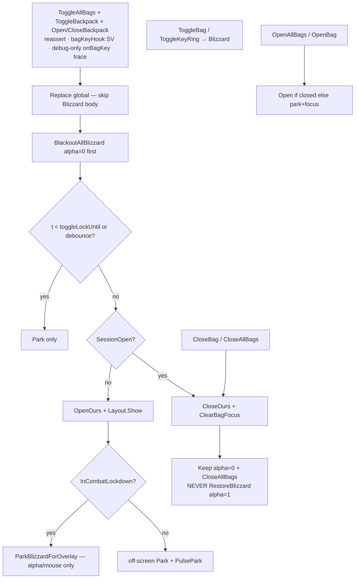
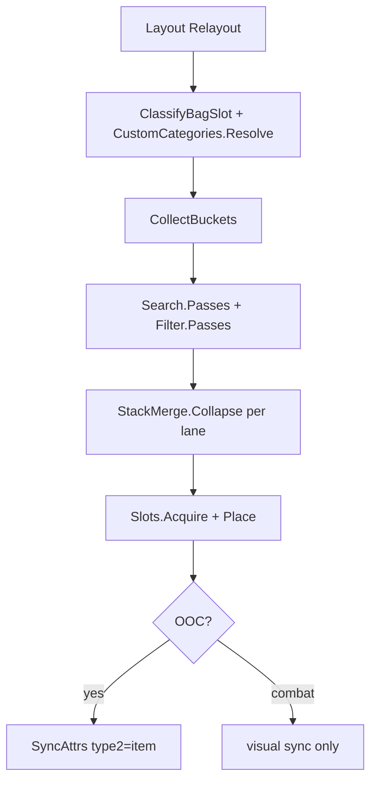
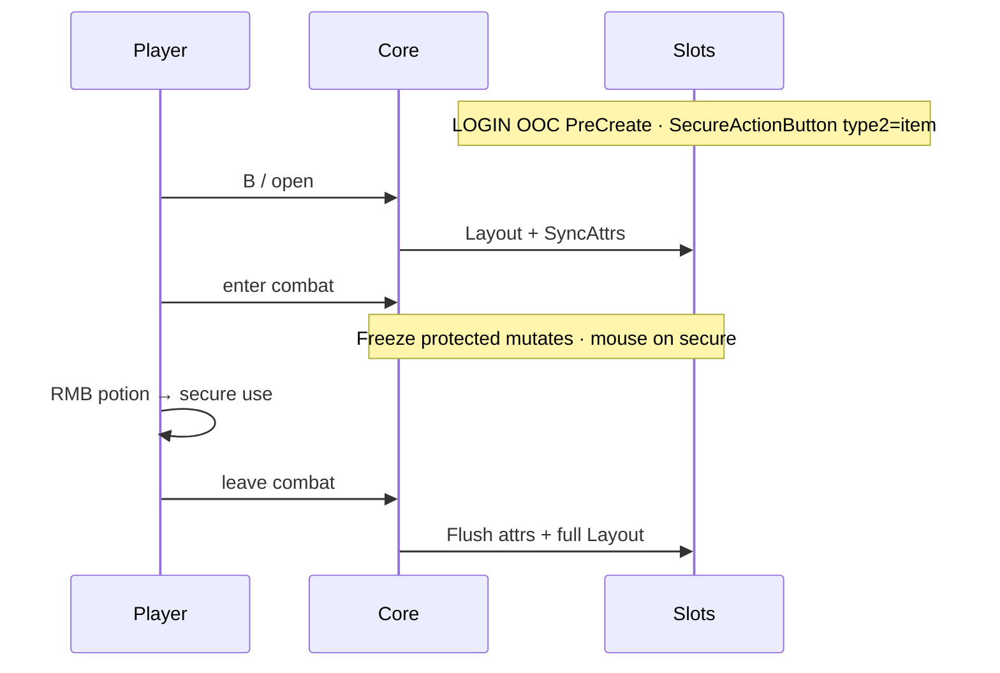
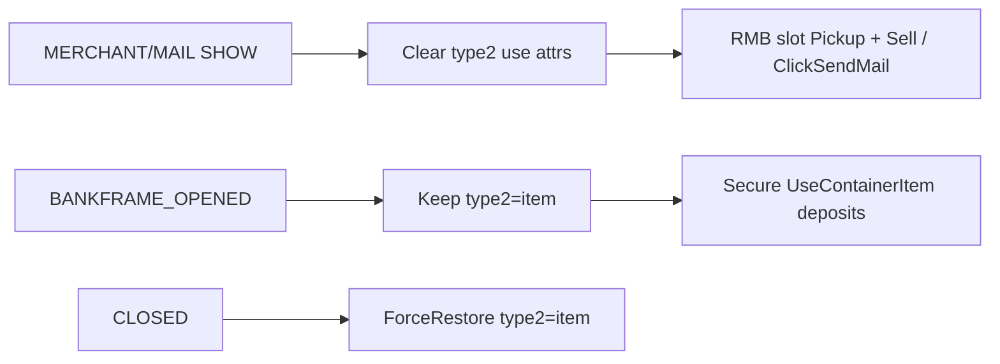
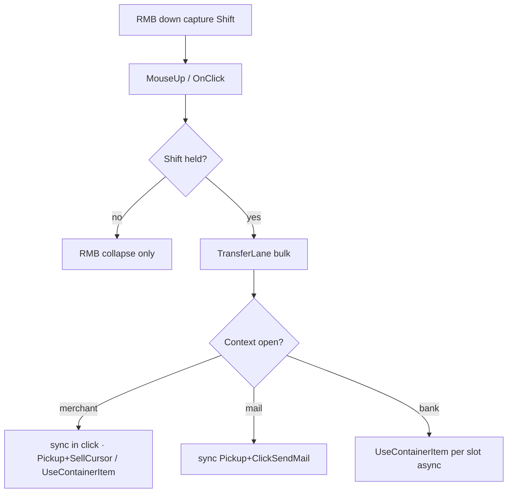

# BetterBackpack — workflows and diagrams

**Code:** `Core.lua`, `Modules/{Slots,Layout,Context,BulkTransfer,VendorJunk,OpenClose,Tidy,Settings,Search,Filter,CustomCategories,Trash,StackMerge,Pins,LayoutModes}.lua`  
**Version reference:** 1.0.0 (combat keep-shown shell · sync vendor lane bulk · auto-sell grey · OpenAllBags→OpenOurs)  
**CS-RMB:** path **B** — `SecureActionButtonTemplate` attrs OOC (never harvest CombinedBags items).

---

## 1. Open / close (B → BetterBackpack)



**Rules**

- Never `SetOverrideBindingClick` or `SetFrameStrata` / `SetToplevel` on our frame.
- Toggle globals are **replaced**, not post-hooked.
- Combat (**1.0**): `_bbKeepShown` — main frame stays shown at alpha 0; open = alpha 1 only (no `Show()` in lockdown). **ESC:** strip from `UISpecialFrames` when alpha &lt; 0.05; `CloseSpecialWindows` guard.
- `OpenAllBags` / `OpenBag` → `OpenOurs` when replace is on (vendor keeps BB, not native CombinedBags).
- Window size is computed from the full unfiltered bag with all lanes expanded (sticky while open).

---

## 2. Layout



Optional feature modules: `Feat("Name")` lookups — Layout does not crash if a module is omitted from TOC.

---

## 3. Combat RMB (CS-RMB)



---

## 4. Vendor / mail / bank



### 4b. Lane header bulk (Shift+RMB, OOC)



- **RMB** without Shift = lane collapse only.
- **Shift+RMB** at vendor: full lane via `Layout.ListLaneSlots(unfiltered)`; sells run **synchronously** in the header click (Forever blocks deferred Pickup/Sell).
- **Auto-sell:** `MERCHANT_SHOW` + Settings — greys only; optional Junk lane non-grey (`VendorJunk`).

---

## 5. Sort OOC

```mermaid
flowchart TD
  Sort[/bb sort]
  Sort --> Combat{InCombatLockdown?}
  Combat -->|yes| Defer[message · bail]
  Combat -->|no| Native[C_Container.SortBags]
  Native --> Settle[suppress refresh · one Layout ~0.55s]
```

---

## 6. Drag-teach lanes

Drop an item on a lane header (or an item in another lane) to teach `profile.itemRules`. Drop back on its natural lane to forget. Out of combat only.

---

## 7. Trash lane

Click-only destroy on Forever (no timer delete). See `Docs/README.md` and `/bb trashtest`.