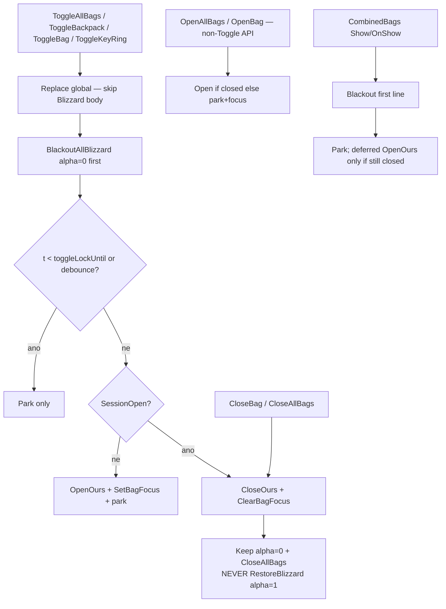
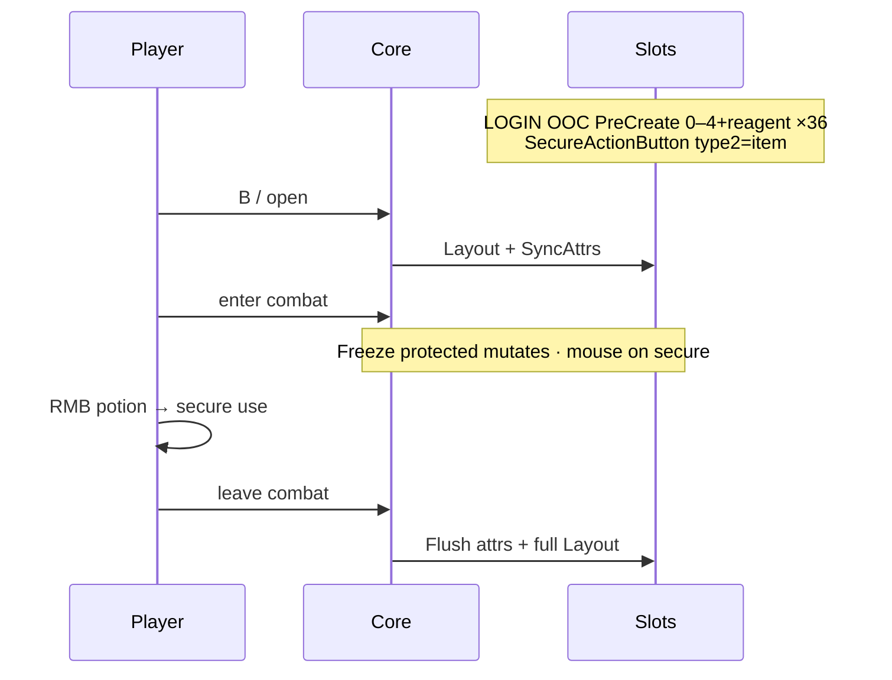
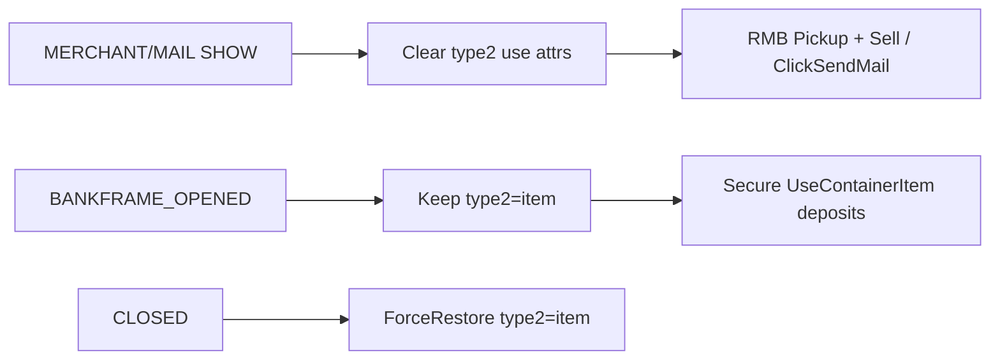

# BetterBackpack — smyčky a grafy

**Kód:** `Core.lua`, `Modules/{Slots,Layout,Context,OpenClose,Tidy,Settings,Search,Filter,CustomCategories,StackMerge,Pins,LayoutModes}.lua`  
**Verze reference:** 0.5.16 (broom = stejná plate jako gear/X · sticky velikost okna · broom/gear v chrome Close · bank RMB secure type2=item · SearchBoxTemplate search · gear na nativní broom plate · nativní AutoSort reparent · footer hairline · pevná velikost = plný rozbalený bag · dense grid PAD 2 · NumberFontNormalSmall counts · broom/gear jako CombinedBags · footer N/M = font peněz · fill wells default off)  
**Stabilita:** Project `docs/bag-addon-brief.md` + Scenario Maps `docs/scenarios/BetterBackpack/`  
**CS-RMB:** path **B** — `SecureActionButtonTemplate` attrs OOC (never path C harvest).

---

## 1. Open / close (B → BetterBackpack)



**Pravidla**

- Nikdy `SetOverrideBindingClick`.
- Forever: never call `SetFrameStrata` / `SetToplevel` in Lua. **0.5.5+:** `ButtonFrameTemplate` + CombinedBags NineSlice/TopTile/Bg at Baganator Forever offsets (6,-21); **Inset:Hide**; empty `SlotBackground` on slots; footer inside bottom border.
- **0.5.3+:** `Toggle*` are **replaced**, not `hooksecurefunc`. Post-hooks ran after Blizzard `Open*`/`Close*` → open/close thrash that froze on B.
- Anti-flash: `Show`/`OnShow`/`onToggle` → **Blackout alpha=0 first**; CloseOurs never `RestoreBlizzardBags`. OpenOurs fail → `ForceCloseBlizzard` (not Unblackout).
- CombinedBags stays `IsShown`+parked while ours open — **ne** `:Hide()` mid-session.
- `SuppressReplace`; OnShow nesmí ClearSuppress→OpenOurs.
- **ToggleBag + bag-bar OnClick = XOR** (same as B; `toggleLockUntil` after replaced ToggleBag). OpenBag/OpenAllBags = open-only. CloseBag/CloseAllBags close ours.
- HookScript OnClick only on frames with `HasScript("OnClick")` / Button — never throw on BagsBar chrome kids.
- Bag focus: `Layout.SetBagFocus(id)` highlights that bag’s slots after open.
- Frame size (**0.5.8 fixed**): počítá se vždy z **plného bagu — nefiltrovaný, všechny lanes rozbalené** (`CollectBuckets(true)`, collapse ignorován). `cols = clamp(nejširší lane, MIN_COLS=6, Columns())` (Columns = profile 10, dense ≥12). Grid = `cols*37 + (cols-1)*2` (PAD 2, dense); outer = `INSET_X + grid + INSET_X` (INSET_X=14); výška = TOP_CHROME 54 + lanesH + BOT_CHROME 30. HEADER_H 18, SECTION_GAP 4.
- Collapse / Search / Filter / „No matches“ **nikdy nemění velikost okna**; během otevření ho nezmenší ani úbytek itemů (sticky 0.5.15), roste jen při novém lootu. Lanes bez shody se skryjí i s headerem. Uvolněné místo zůstane prázdné (Bg). Opt-in: `profile.fillEmptyWells = true` → prázdné wells `bags-item-slot64` (0.5.9 default **false**, schema 4 vypne i uložené true).
- Header (0.5.7) = Baganator Forever: atlas `bag-arrow` 14×14 (rozbaleno rotace π/2, sbaleno −π; fallback UI-Minus/PlusButton), label `GameFontNormalMed2`, počet `(n)` `GameFontDisableSmall`, hover = bílý label.
- Slot art (0.5.7) = ContainerFrameItemButton: Normal/Pushed/Highlight + IconBorder čtené z hidden `ItemButtonTemplate` (fallback UI-Quickslot2 64×64 CENTER 0,-1 / Quickslot-Depress / ButtonHilight-Square ADD / WhiteIconFrame), ikona full texcoord v `BORDER`, well `bags-item-slot64`. Count (0.5.8) `NumberFontNormalSmall` bílý BOTTOMRIGHT −3,2 (i StackMerge — žádný cyan).
- Kategorie jsou **default rozbalené**; klik na header = per-profile toggle. Schema 3 (0.5.6) jednorázově maže `collapsed` zaseknutý z 0.5.4/0.5.5 (prázdné lanes → hráč zavřel všechny headery).
- Lua 5.1: helper volaný z `DoLayout` / `SyncVisual` / `Acquire` musí být deklarovaný **nad** volajícím (nebo forward `local X` + `X = function`). 0.5.4/0.5.5 volaly `ApplyCombinedBagsChrome` / `EnsureSlotBackground` jako nil global → DoLayout abort na prvním itemu (žádné ikony, frame se nezmenšil).
- Title chrome (0.5.16): broom | gear | X v jedné řadě, obě tlačítka **přesně velikosti Close** (živě `close:GetWidth/Height`), mezera 2px, na střed X. **Chrome = art samotného Close** (normal / pushed / highlight přečtené živě, stejná atlas/soubor + geometrie). X zakryje výřez téže plate (pás nahoře uprostřed mezi rameny X, `GetAtlasInfo`/`GetTexCoord`; na press se přepne na pushed art). Glyph: broom = `bags-button-autosort-up` oříznutá **hluboko uvnitř bevelu (0.24–0.76)**, `ADD`, desaturovaná + stejný zlatý tón jako gear, velikost 66 % (0.5.16: širší ořez 0.16–0.84 přidal stříbrný rám a hnědou výplň → celá plate oranžová); gear = ověřená gear atlas, desaturovaná + zlatý tón jako X. **Žádný reparent `BagItemAutoSortButton`** (0.5.10–0.5.14 vypadal menší / posunutý). Fallback bez Close = AutoSort twin.
- Search (0.5.11): EditBox z `SearchBoxTemplate` (= vzhled `BagItemSearchBox`: common-search-border, lupa, clear X, "Search"). Nikdy `BagSearchBoxTemplate` (SetItemSearch → druhý CombinedBags). Query = `profile.searchQuery`, OnTextChanged hook (i clear X), Esc vymaže. Fallback plochý box, když template chybí.
- Velikost okna (0.5.15): grid = nejširší **nefiltrovaná** lane, výška = všechny lane rozbalené + nefiltrované. Navíc **sticky** během otevření (`stickyCols`, `stickyH`): okno jen roste (nový loot), collapse / search / spotřeba itemů / pins ho nikdy nezmenší. `Layout.Hide` (zavření) reset → další otevření se znovu napasuje na plný layout.
- Footer N/M (0.5.9): hairline 1px (bílá α0.14, PixelUtil) nad footerem (0.5.10); font = font peněz (`<money>CopperButton:GetFontString()`), baseline zarovnaný na text peněz; barva dle zaplnění. Počítá player bags `0..NUM_BAG_SLOTS` + **reagent bag** (Materials lane). Never keyring invent (102=70+32).
- Slots: `Normalize` 37×37 on every `Place` and after `SetItemButtonQuality`.
- CombinedBags/Container OnShow: park now; **defer** open to next tick (non-Toggle Open* only).

---

## 2. Layout — own SAB only (+ NTH Feat hooks)

```mermaid
flowchart TD
  L[Layout Relayout]
  L --> Class[ClassifyBagSlot + CustomCategories.Resolve]
  Class --> Buckets[CollectBuckets]
  Buckets --> SF[Search.Passes + Filter.Passes]
  SF --> Merge[StackMerge.Collapse per lane]
  Merge --> Filt{Search / Filter active?}
  Filt -->|ano| Full[sizing = CollectBuckets unfiltered]
  Filt -->|ne| Same[sizing = rendered lists]
  Full --> Hug[cols + lanesH from sizing · every lane EXPANDED · clamp widest lane, 6, Columns · cols ≥ stickyCols]
  Same --> Hug
  Hug --> Col{lane has matches?}
  Col -->|ne| HideH[hide header]
  Col -->|ano| Coll{collapsed?}
  Coll -->|ano| Hdr[header only · bag-arrow −π]
  Coll -->|ne default| Place[Slots.Acquire + Place on main · SlotBackground well · ApplyDisplayCount]
  Hdr --> Pins
  HideH --> Pins
  Place --> Pins[Pins.Layout ghosts for missing · same cols]
  Pins --> Size[main:SetSize: INSET+grid+INSET × max(TOP+lanesH+BOT, stickyH) · store sticky]
  Close2[Layout.Hide on close] -.->|reset stickyCols/H| Hug
  Size --> Wells{fillEmptyWells? default off}
  Wells -->|on| WellsOn[empty bags-item-slot64 in freed space]
  WellsOn --> Chrome
  Wells -->|off| Chrome[ApplyCombinedBagsChrome NineSlice/Bg/TopTile · EnsureTitleChrome · Search.EnsureChrome]
  Chrome --> Sort[EnsureTitleChrome: broom + gear in Close chrome · X (Close size, gap 2) · SearchBoxTemplate]
  Sort --> Foot[footer hairline · UpdateFreeSpace N/M in money font + money]
  Place --> Attrs{OOC?}
  Attrs -->|ano| Sync[SyncAttrs type2=item]
  Attrs -->|ne combat| Keep[Keep prior attrs · visual sync]
  Place --> Unused[ParkUnused off-screen]
```

Žádný harvest / `SetParent` CombinedBags.Items.  
Feature modules are optional `Feat("Name")` lookups — TOC can omit a file without Layout crash.  
`LayoutModes.Columns` densifies grid; stack merge is visual-only (first real bag:slot keeps clicks).  
Title chrome / AutoSort twins remain the 0.4.x path — NTH does not own OpenClose.

---

## 3. Combat RMB (CS-RMB)



---

## 4. Vendor / mail / bank



- **Bank:** never clear `type2` / never Pickup+`PutItemInBag` from OnClick — secure SAB `type2=item` = native CombinedBags deposit (OOC). Detect `BankFrame` / `BankPanel`.
- **Merchant/mail:** `NeedsInsecureSpecialRmb` → clear type2 + Pickup path.
- Mail: `MailFrame:IsVisible()` — ne stuck SendMailFrame alone.

---

## 5. Sort OOC

```mermaid
flowchart TD
  Sort[/bb sort]
  Sort --> Combat{InCombatLockdown?}
  Combat -->|ano| Defer[message · bail]
  Combat -->|ne| Native[C_Container.SortBags]
  Native --> Settle[suppress refresh · one Layout ~0.55s]
```
