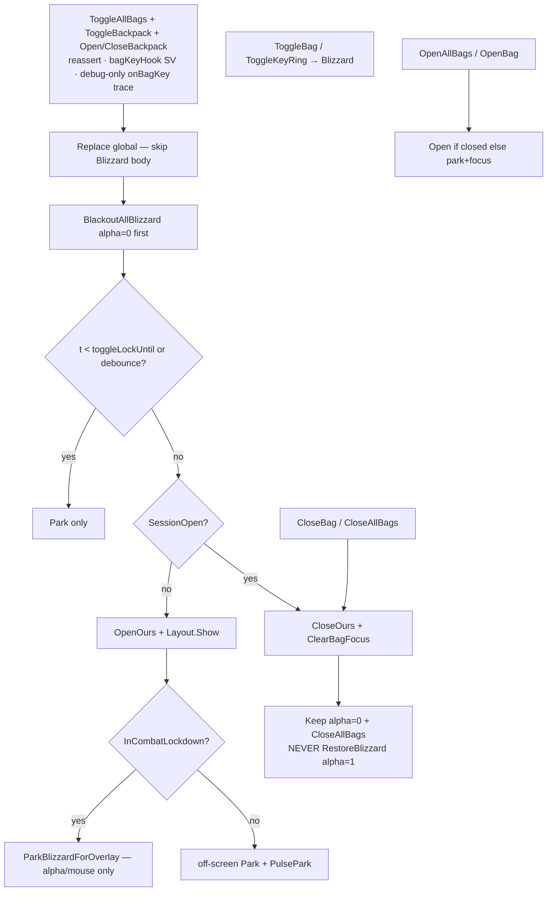
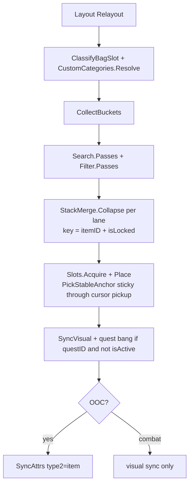
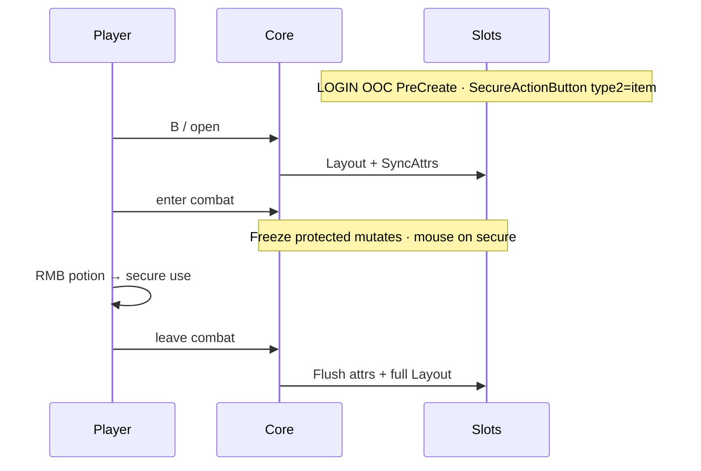
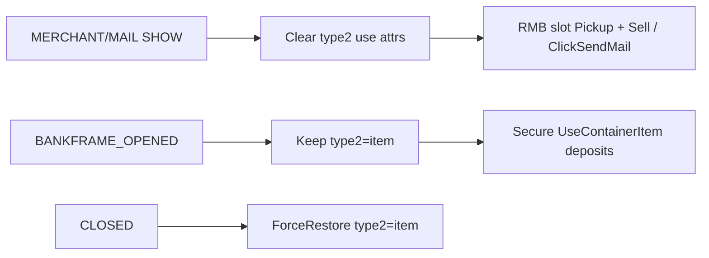
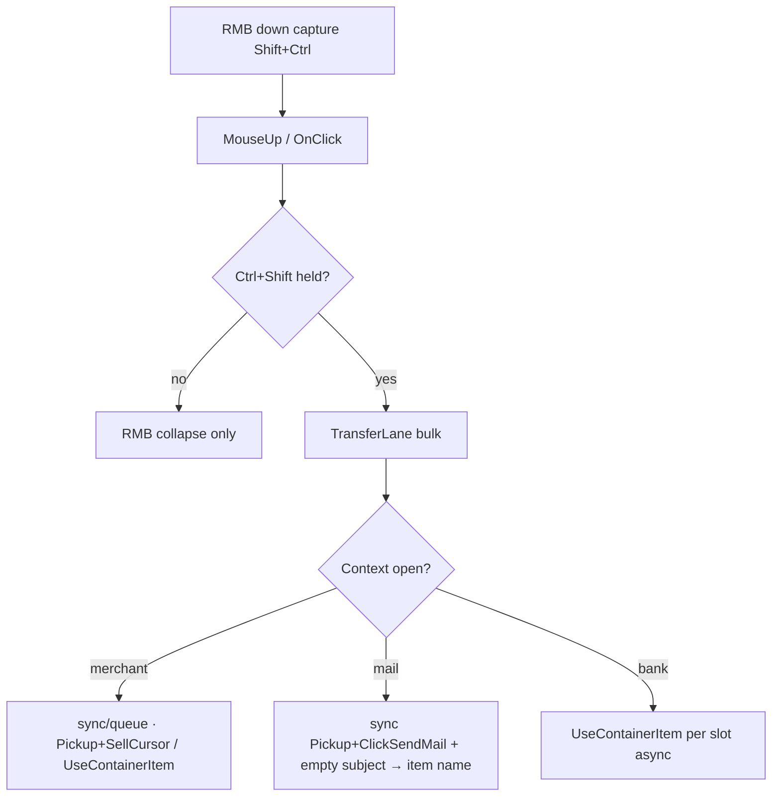
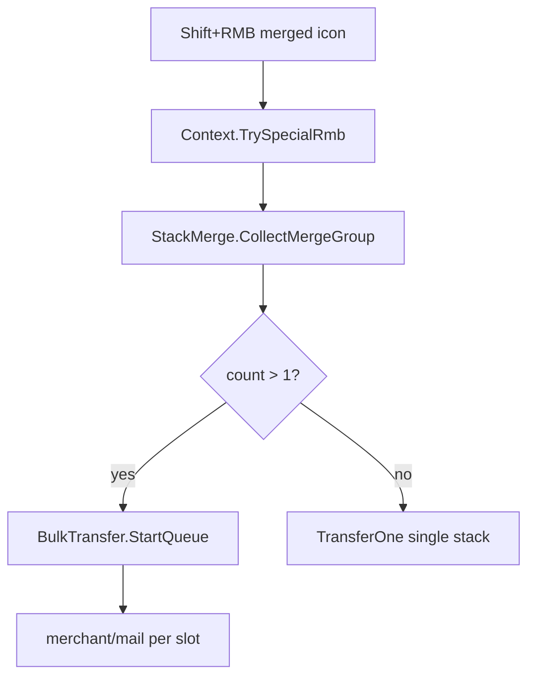

# BetterBackpack — workflows and diagrams

**Code:** `Core.lua`, `Modules/{Slots,Layout,Context,BulkTransfer,VendorJunk,OpenClose,Tidy,Settings,Search,Filter,CustomCategories,Trash,StackMerge,Pins,LayoutModes}.lua`  
**Version reference:** 1.2.2 (merged stack Shift+RMB · Recipes lane · Ctrl+Shift+RMB lane bulk)  
**CS-RMB:** path **B** — `SecureActionButtonTemplate` attrs OOC (never harvest CombinedBags items).

---

## 1. Open / close (B → BetterBackpack)



**Rules**

- Never `SetOverrideBindingClick` or `SetFrameStrata` / `SetToplevel` on our frame.
- Toggle globals are **replaced**, not post-hooked.
- Combat: OOC **`EnsureCombatShell`** parks **Show+alpha0** (`_bbKeepShown`); B in combat = alpha 1/0. **ESC:** `SyncBagUISpecialFrame` — user-visible ⇔ `UISpecialFrames`. Parked → `CloseSpecialWindows` transient `Hide` + **re-arm**; **`CloseBackpack`** close-only (no toggle open when parked).
- `OpenAllBags` / `OpenBag` → `OpenOurs` when replace is on (vendor keeps BB, not native CombinedBags).
- Window size is computed from the full unfiltered bag with all lanes expanded (sticky while open).

---

## 2. Layout



Optional feature modules: `Feat("Name")` lookups — Layout does not crash if a module is omitted from TOC.

- **Bag events:** `QueueBagRefresh` → `RefreshLight` (sync + `StackMerge.RefreshMergedButtons`); full `DoLayout` when occupied count, **grid signature (incl. merge anchor bag.slot)**, or `VisibleRepaintNeeded` (empty merged cell on cursor), else explicit `Relayout`.

- **Custom lanes:** `BetterBackpackDB.chars["Name-Realm"].customCategories` + char `itemRules` (custom_*). Built-in lane toggles remain on `profile`. `PLAYER_ENTERING_WORLD` → `CustomCategories.OnCharacterActive` refreshes layout on character switch.

---

## 3. Combat RMB (CS-RMB)



---

## 4. Vendor / mail / bank



### 4b. Lane header bulk (Ctrl+Shift+RMB, OOC)



- **RMB** without modifiers = lane collapse only.
- **Ctrl+Shift+RMB** lane header: full lane via `Layout.ListLaneSlots(unfiltered)` (vendor/mail/bank).
- **Auto-sell:** `MERCHANT_SHOW` → `VendorJunk` collects inventory slots → `BulkTransfer.TransferSlotList` (merchant queue). **Per character** (`BetterBackpackDB.chars`): grey toggle, optional Junk lane non-grey, optional **marked** itemIDs (Settings → Features drag row). Settings preview lists items in bags that will sell.

### 4c. Merged stack bulk (Shift+RMB slot, OOC)



- **RMB** on a **merged** icon at vendor/mail = all stacks in merge group (`CollectMergeGroup`; shift optional via latch).
- **Mail subject:** `BulkTransfer.MaybeFillMailSubject` — if `SendMailSubjectEditBox` is empty, first attach sets localized item display name (single RMB via `Context.TrySpecialRmb`, bulk via `TransferMail` queue).
- Single-stack slot (not merged) = one physical stack on RMB.

---

## 5. Sort OOC

```mermaid
flowchart TD
  Sort[/bb sort]
  Sort --> Combat{InCombatLockdown?}
  Combat -->|yes| Defer[message · bail]
  Combat -->|no| Native[C_Container.SortBags]
  Native --> Settle[suppress refresh · one Layout ~0.55s]
```

---

## 6. Drag-teach lanes

Drop an item on a lane header (or an item in another lane) to teach `profile.itemRules`. Drop back on its natural lane to forget. Out of combat only.

---

## 7. Trash lane

Click-only destroy on Forever (no timer delete). See `Docs/README.md` and `/bb trashtest`.