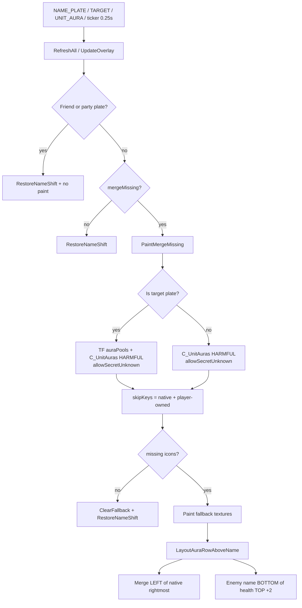

# Plateband — aura / layout loops

Version: **0.1.9**

## Merge-missing (enemy plates)

## Friend / party plates (Pichy)

- **No** `ClearAllPoints` on name or DebuffList.
- Any shift left from ≤0.1.8 is restored on refresh.
- `CountShownAuraKids` requires `Icon` / `icon` / `GetAuraInstance` (no bare Frame false positives).

## Hard rules

- Never park/hide native DebuffList.
- Never SetPoint DebuffList (Forever FORBIDDEN).
- No CLEU core · no plate HP recolor.
