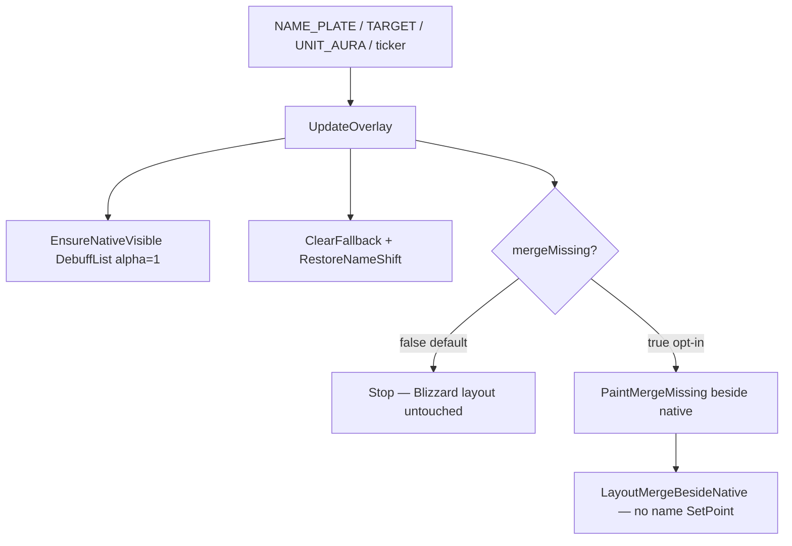

# Plateband — aura / layout loops

Version: **0.1.12**

## Safe default (native DebuffList only)

## Hard rules

- Never park/hide native DebuffList.
- Never SetPoint DebuffList (Forever FORBIDDEN).
- Never ClearAllPoints / SetPoint UnitFrame.name (0.1.8–0.1.11 broke plates).
- No CLEU core · no plate HP recolor.
