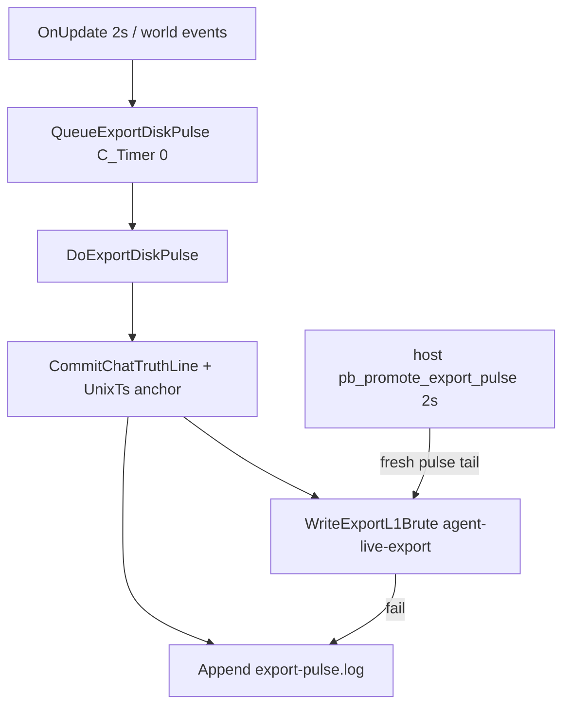
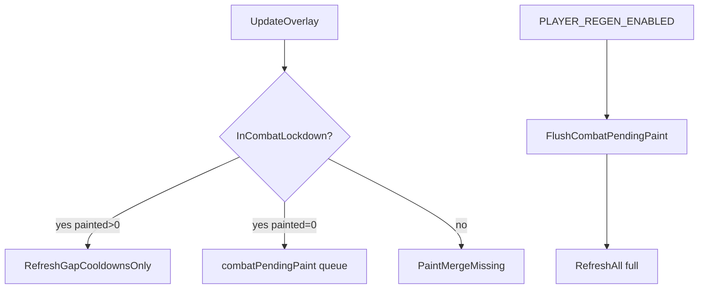

# Plateband — aura / layout loops

Version: **0.3.00** (export pulse; reload = TOC only)

## Export L1 pulse (agent feed)

See also: [merge-design.md](merge-design.md) (default merge on 0.1.15+, no name mutation).

## Safe default (native DebuffList only)

## Combat lockdown

## Hard rules (three-addon refactor)

- Never park/hide native DebuffList.
- Never SetPoint DebuffList (Forever FORBIDDEN).
- **Never ClearAllPoints / SetPoint UnitFrame.name** (preference + 0.1.8–0.1.11 postmortem).
- No CLEU · no plate HP recolor · no bags (BetterBackpack owns bags).
