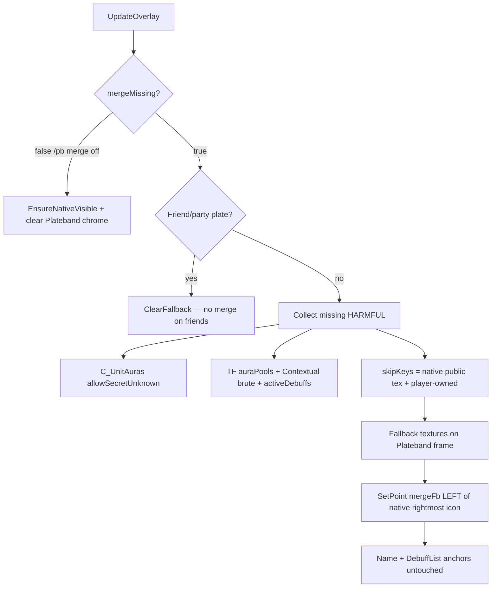

# Plateband — safe merge design (no name mutation)

**Status:** shipped under three-addon refactor · **default ON** (`mergeMissing=true`, schema 7+)  
**Versions:** safe baseline **0.1.12+**; **`/pb merge off`** for native-only (**0.1.15+**)

## Goal

Append **only** party/nearby foreign harmful DoTs that native DebuffList omits, on the **same above-plate band**, without touching Blizzard name / DebuffList anchors.

## Hard rules (non-negotiable)

| Rule | Why |
|------|-----|
| **Never** `ClearAllPoints` / `SetPoint` on `UnitFrame.name` | 0.1.8–0.1.11 broke Forever plates (Golm/Pichy / “completely broken”) |
| **Never** `ClearAllPoints` / `SetPoint` / `Hide` / `SetAlpha(0)` on DebuffList | Forever FORBIDDEN / sacred native band |
| **Never** paint player-owned harmful already on native | No duplicate personal icons |
| **No CLEU** as core | Forever policy |
| Bags stay in **BetterBackpack** | Three-addon split; Plateband plates-only |

## Data flow (`mergeMissing=true`, default since 0.1.15)



## Layout contract

1. Native DebuffList stays where Blizzard put it (above bar / engine layout).
2. Plateband fallback frame parents to plate `UnitFrame` (non-forbidden) with `EnableMouse(false)`.
3. Anchor: `mergeFb LEFT → rightmost shown native aura RIGHT` (+ pad). Fallback: `BOTTOM` of health `TOP` if no native kids.
4. **Name text:** leave alone. Overlap with native auras is an engine/CVar concern — not fixed by Plateband SetPoint.

## Sources (target vs non-target)

| Plate | Sources |
|-------|---------|
| Current **target** | `C_UnitAuras` HARMFUL on `target` + nameplate token; TargetFrame auraPools / Contextual brute / `activeDebuffs` |
| Other **enemy** | `C_UnitAuras` on `nameplateN` only (no TF) |
| Friend / party | No merge |

Skip: `AuraIsPlayerOwned == true`; native public texture keys.

## Disable merge (native-only)

Default is **on** since 0.1.15 (schema 7 migrates prior opt-in off → on).

```
/pb merge off
```

Expect `/pb diagnose` `merge=1` by default; `fb>0` when TF/API shows foreign DoTs native omits; solo personal DoTs stay `fb=0`, `native>0`.

## Coordination (BetterBackpack / ForeverErrorLog)

- **No shared frames** with BB. Plateband ignores non-Plateband `ADDON_ACTION_BLOCKED` (BB strata spam must not drive Plateband diagnose).
- OptionalDeps ForeverErrorLog only for error capture — no FELog UI coupling.
- BB owns bags chrome (native templates); Plateband owns plates only.
