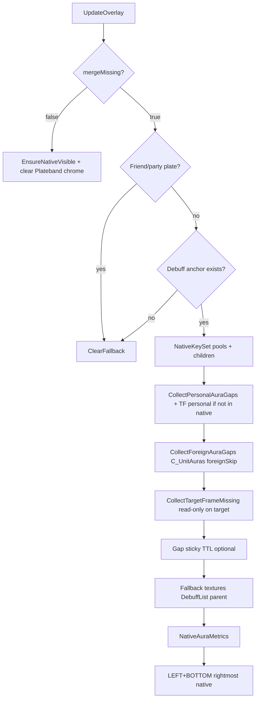

# Plateband — safe merge design (no name mutation)

**Status:** v0.2.5 P0+P1 (`pb-old-vs-peers-dots.md` §5) · **default ON** (`mergeMissing=true`, schema 7+)  
**Baseline:** `plateband-v0.1.15` data contract + **0.2** beside-native layout · HUD gate before main merge

## Product rule (0.2.5)

**One native-looking harmful row** on enemy **target** nameplates (e.g. Rake + timer left of health): Blizzard `DebuffList` / `auraPools` kids first; Plateband paints **personal gaps** (player DoTs missing from native) then **foreign gaps**. Dedupe **only** `NativeKeySet` for personal; `CollectPlayerOwnedKeys` applies to **foreign** skip set only. Gaps match **native kid size** (`NativeAuraMetrics`), appended **RIGHT of rightmost native** with **BOTTOM** band align. Gap icons are texture-only (timers on native). **No** AuraContainer overlay row.

## Hard rules (non-negotiable)

| Rule | Why |
|------|-----|
| **Never** `ClearAllPoints` / `SetPoint` on `UnitFrame.name` | 0.1.8–0.1.11 broke Forever plates |
| **Never** `ClearAllPoints` / `SetPoint` / `Hide` / `SetAlpha(0)` on DebuffList | Forever FORBIDDEN |
| **Never** parent plate band to `UIParent` / HUD | UI vanish incident |
| **Never** mutate TargetFrame / TF buttons (read-only scrape OK) | Incident + taint |
| **No CLEU** | Forever policy |

## Data flow (`mergeMissing=true`)

## Layout

1. Native DebuffList untouched.
2. Fallback parents to `DebuffList` / `AurasFrame` (`FallbackParent`), not `UIParent`.
3. Anchor: rightmost native aura from **pools** or `DebuffListFrame`; health-bar fallback only if no kid.
4. `pcall` on paint + layout; debounce `UNIT_AURA` on target.

## Sources

| Plate | Source |
|-------|--------|
| Target enemy | `NativeKeySet` → `C_UnitAuras` foreign (`owned~=true`, skip native keys) → **`CollectTargetFrameMissing`** → `nameplateN` token |
| Other enemy | `C_UnitAuras` on `nameplateN` only (no TF) |
| Friend / party | No merge |

`CollectPlayerOwnedKeys` → `skipKeys` (secret dedupe only; **not** personal fallback paint).

## `/pb merge off`

Native only; Plateband chrome cleared.