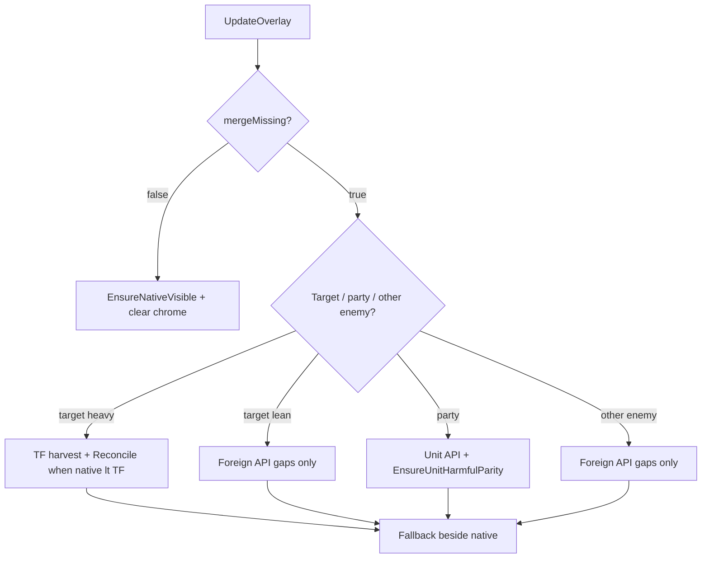

# Plateband — safe merge design (no name mutation)

**Status:** v0.2.70 · **default ON** (`mergeMissing=true`, schema 7+)  
**Baseline:** `plateband-v0.1.15` data contract + **0.2** beside-native layout · HUD gate before main merge

## Product rule (0.2.7 → 0.2.41)

**One native-looking harmful row** on enemy **target** nameplates: Blizzard `DebuffList` first; Plateband paints **personal gaps only when native omitted** them, then **foreign gaps**. Dedupe via **`MarkAllAuraKeys`** (inst + spell + tex) so native `inst:` and API `spell:` cannot double-paint the same DoT (0.2.40 Flame Shock fix). **`IsPlateHarmfulAuraButton`** on plate harvest — friendly plates must not treat PW:S buffs as native harmful (0.2.41 Weakened Soul). `EnsureTargetHarmfulParity` tops up TF/API vs native (heavy + lean target paths). Gaps use **fixed** merge size. Appended **RIGHT of rightmost native** (or **BuffList** when DebuffList empty on friendlies). **No** AuraContainer overlay row.

## Hard rules (non-negotiable)

| Rule | Why |
|------|-----|
| **Never** `ClearAllPoints` / `SetPoint` on `UnitFrame.name` | 0.1.8–0.1.11 broke Forever plates |
| **Never** `ClearAllPoints` / `SetPoint` / `Hide` / `SetAlpha(0)` on DebuffList | Forever FORBIDDEN |
| **Never** parent plate band to `UIParent` / HUD | UI vanish incident |
| **Never** mutate TargetFrame / TF buttons (read-only scrape OK) | Incident + taint |
| **No CLEU** | Forever policy |

## Data flow (`mergeMissing=true`)

## Layout

1. Native DebuffList untouched.
2. **Paint row** parents via `FallbackPaintParent` → `AurasFrame` / `UnitFrame` only (never **child of** `DebuffList` — sibling overlap). `FallbackParent` still names native scrape anchor.
3. Anchor: **SetPoint** beside rightmost native pool button; else **`DebuffListFrame` BOTTOMLEFT** + `gapOff` from `nativeN` when `nativeVis=0`; never health-bar-top on hostiles. PAINT logs **`gapBand`** (`rightNative` / `DebuffList`) + **`nativeVis`**. Party friend paint: **`PlateUnitBindingMatches`** — not `GetNamePlateForUnit` pointer equality (0.2.69 Renia WS).
4. `pcall` on paint + layout; debounce `UNIT_AURA` on target; **gap sticky** 3s hostile / **18s friend-party** (WS); refresh on hold; hostile merge **debuff band only** (never health-bar-top); merge offset when no rightmost native anchor (no overlap).

## Sources

| Plate | Source |
|-------|--------|
| Target enemy | `NativeKeySet` → `C_UnitAuras` foreign (`owned~=true`, skip native keys) → **`CollectTargetFrameMissing`** → `nameplateN` token |
| Other enemy | `C_UnitAuras` on `nameplateN` only (no TF) |
| Party / raid / player NP | **`mergeFriendPlates`** (default on): same harmful gap merge via unit `C_UnitAuras` + `EnsureUnitHarmfulParity` — **not** ambient friendly stranger plates (0.2.30) |

`CollectPlayerOwnedKeys` → `skipKeys` (secret dedupe only; **not** personal fallback paint).

## `/pb merge off`

Native only; Plateband chrome cleared.