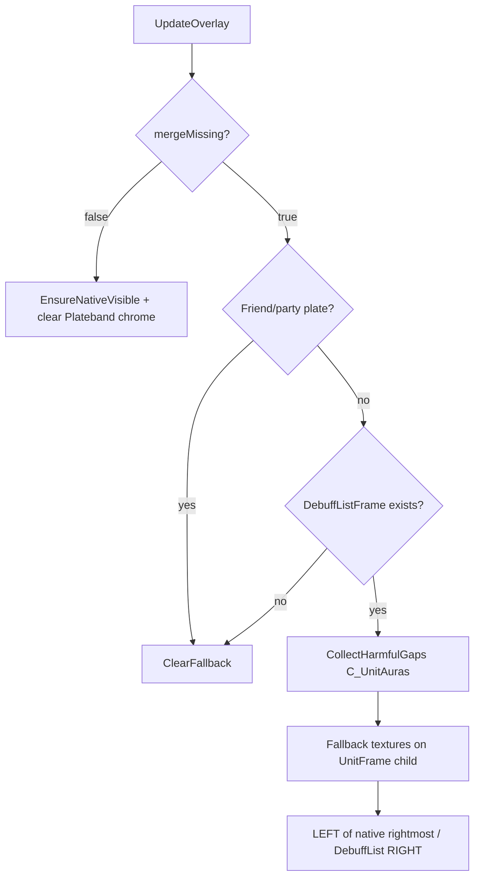

# Plateband — safe merge design (no name mutation)

**Status:** v0.2.0 native-row gap fill · **default ON** (`mergeMissing=true`, schema 7+)  
**Baseline:** `plateband-v0.1.15` · HUD gate before main merge

## Product rule (0.2.0)

**One native-looking harmful row** on enemy nameplates: Blizzard `DebuffList` kids first, then Plateband gap icons (personal + foreign) **same size/pad** as profile `iconSize`, anchored on the **debuff row only**. No TargetFrame scrape. No AuraContainer overlay row.

## Hard rules (non-negotiable)

| Rule | Why |
|------|-----|
| **Never** `ClearAllPoints` / `SetPoint` on `UnitFrame.name` | 0.1.8–0.1.11 broke Forever plates |
| **Never** `ClearAllPoints` / `SetPoint` / `Hide` / `SetAlpha(0)` on DebuffList | Forever FORBIDDEN |
| **Never** parent plate band to `UIParent` / HUD | UI vanish incident |
| **Never** TF button / brute scrape for paint | Incident + taint |
| **Single collector** | `C_UnitAuras` HARMFUL only (`CollectHarmfulGaps`) |
| **Dedupe** | `NativeKeySet` — never duplicate native textures |
| **No CLEU** | Forever policy |

## Data flow (`mergeMissing=true`)

## Layout

1. Native DebuffList untouched.
2. Fallback parents to `plate.UnitFrame` (`SafeFallbackParent`).
3. Anchor only: rightmost native aura **or** `DebuffListFrame` RIGHT — **no** health-bar TOP anchor.
4. `pcall` on paint + layout; debounce `UNIT_AURA` on target.

## Sources

| Plate | Source |
|-------|--------|
| Target enemy | `C_UnitAuras` on `target` + `nameplateN` token |
| Other enemy | `C_UnitAuras` on `nameplateN` |
| Friend / party | No merge |

Secret ownership: personal always eligible if key ∉ native; foreign when `owned==false` or `AuraLooksForeign`; unknown secrets only when `nativeN==0`.

## `/pb merge off`

Native only; Plateband chrome cleared.